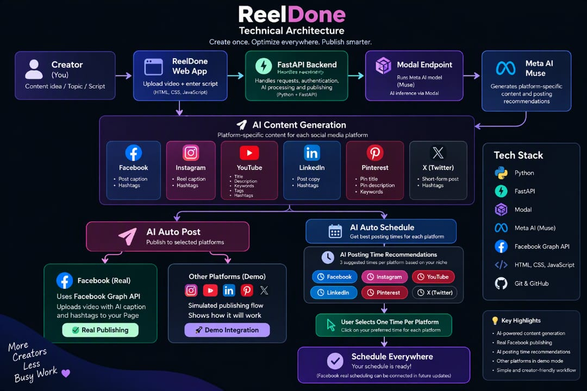

ReelDone
Create once. Optimize everywhere. Publish smarter.
ReelDone is an AI-powered social media publishing agent for creators. A creator provides one video and a topic or script, and ReelDone generates platform-specific content, recommends posting times, and enables real publishing to Facebook from one simple workflow.
The Problem & Solution
The Problem
Creators often publish the same content across multiple social platforms, but every platform expects content in a different format.
A single video may require:
•A Reel caption and hashtags for Instagram
•A post caption and hashtags for Facebook
•A title, description, keywords, and tags for YouTube
•Professional post copy for LinkedIn
•Short-form content for X
•A title, description, and keywords for Pinterest
This forces creators to repeatedly rewrite, optimize, format, and prepare the same content for different platforms.
The Solution
ReelDone simplifies this workflow.
The creator provides:
1.A video
2.A topic, idea, or script
ReelDone then uses AI to generate platform-specific content instead of returning one generic caption for every platform.
The creator can review the generated content, connect social platforms, publish to Facebook, or use AI-generated posting-time recommendations.
One idea. Multiple platforms. One creator workflow
Core Features
AI-Powered Platform-Specific Content
ReelDone generates different content based on the platform.
YouTube
•Title
•Description
•Keywords
•Tags
•Hashtags
Instagram
•Reel caption
•Hashtags
Facebook
•Post caption
•Hashtags
LinkedIn
•Post copy
•Hashtags
X
•Short-form post
•Hashtags
Pinterest
•Pin title
•Pin description
•Keywords
Real Facebook Integration
Facebook is ReelDone's real social publishing integration.
The current working implementation includes:
•Facebook authentication
•Facebook Page authorization
•Facebook Page selection
•Real video upload
•AI-generated Facebook captions
•AI-generated hashtags
•Real publishing to a Facebook Page
AI Auto Post
ReelDone provides an AI Auto Post workflow.
For the current hackathon build:
•Facebook publishing is real
•Instagram connection is simulated
•YouTube connection is simulated
•LinkedIn connection is simulated
•Pinterest connection is simulated
•X connection is simulated
The simulated platforms are shown as Demo integrations in the interface.
However, the platform-specific captions, titles, descriptions, hashtags, keywords, and tags are generated by the real AI pipeline.
AI Auto Schedule
ReelDone also includes an AI-powered scheduling assistant.
After analyzing the creator's topic or niche, ReelDone generates three recommended posting times for every supported platform.
The creator can choose one preferred time for:
•Facebook
•Instagram
•YouTube
•LinkedIn
•X
•Pinterest
The current hackathon version demonstrates AI-generated scheduling recommendations and the scheduling-selection workflow.
Automatic future publishing is not executed in the current prototype.

## Technical Architecture

The diagram below shows how ReelDone processes creator input through the AI inference pipeline and separates real Facebook publishing from demo platform integrations.

## Real vs Demo Integrations

ReelDone uses a real Facebook integration for publishing. Other platforms are currently demonstrated as simulated connections, while their platform-specific AI content is generated by the real AI pipeline.

| Platform | Connection | AI Content | Publishing |
|---|---|---|---|
| Facebook | ✅ Real | ✅ Real | ✅ Real |
| Instagram | 🧪 Demo | ✅ Real AI | 🧪 Demo |
| YouTube | 🧪 Demo | ✅ Real AI | 🧪 Demo |
| LinkedIn | 🧪 Demo | ✅ Real AI | 🧪 Demo |
| Pinterest | 🧪 Demo | ✅ Real AI | 🧪 Demo |
| X | 🧪 Demo | ✅ Real AI | 🧪 Demo |

> Demo integrations are clearly marked and are not presented as real API connections.
>flowchart TD

## Technical Architecture

The diagram below shows how ReelDone processes creator input through the AI inference pipeline and separates real Facebook publishing from demo platform integrations.

   
    Tech Stack
Frontend
•HTML5
•CSS3
•Vanilla JavaScript
•Responsive creator-focused interface
Backend
•Python
•FastAPI
•Uvicorn
•Requests
•python-dotenv
•python-multipart

AI & Inference
•Meta AI / Muse
•Modal Endpoint infrastructure
•Structured AI output for platform-specific content generation
•AI-based posting-time recommendations
Social API
•Facebook Login
•Facebook Graph API
•Facebook Page authorization
•Real Facebook video publishing
Development & Testing
•Git
•GitHub
•FastAPI Swagger UI

Real vs Demo Integrations
Setup Instructions
1. Clone the Repository
   git clone https://github.com/aasthaoct7-pixel/REELDONE.git
cd REELDONE
2.Install Backend Dependencies
py -m pip install -r backend/requirements.txt
3. Create Environment File
Create a .env file in the project root.
Example:
MUSE_ENDPOINT_URL=your_modal_endpoint

MODAL_PROXY_TOKEN_ID=your_modal_token_id
MODAL_PROXY_TOKEN_SECRET=your_modal_token_secret

FACEBOOK_APP_ID=your_facebook_app_id
FACEBOOK_APP_SECRET=your_facebook_app_secret

FACEBOOK_REDIRECT_URI=your_facebook_callback_url

FRONTEND_URL=http://127.0.0.1:5500/

Never commit .env, access tokens, API secrets, or private credentials to GitHub.
4. Start the Backend
From the project root:
py -m uvicorn backend.app.main:app --port 8001
FastAPI backend:
http://127.0.0.1:8001
Swagger API documentation:
http://127.0.0.1:8001/docs

Start the Frontend
Open another terminal in the project root:py -m http.server 5500
Open ReelDone:http://127.0.0.1:5500/

Environment Variables
ReelDone keeps credentials outside the source code.
Required configuration includes:
MUSE_ENDPOINT_URL
MODAL_PROXY_TOKEN_ID
MODAL_PROXY_TOKEN_SECRET

FACEBOOK_APP_ID
FACEBOOK_APP_SECRET
FACEBOOK_REDIRECT_URI

FRONTEND_URL
All real credentials should remain inside the local .env file.

Demo Flow
A complete ReelDone demonstration can follow this workflow:
Step 1
Upload a video and enter a content topic or script.
Step 2
Click Generate with AI.
ReelDone generates native content for all supported platforms.
Step 3
Show the platform connections.
Facebook is the real connected platform, while the remaining integrations are clearly displayed as Demo connections.
Step 4
Click AI Auto Post.
ReelDone publishes the selected video to the connected Facebook Page using the AI-generated Facebook caption and hashtags.
Step 5
Click AI Auto Schedule.
ReelDone analyzes the content niche and generates three recommended posting times for each platform.
The creator can select a preferred time for each platform and review the resulting schedule.

Current Hackathon Scope
The current ReelDone prototype focuses on proving a complete AI-assisted creator workflow.
Working
•AI platform-specific content generation
•Facebook authentication
•Facebook Page connection
•Real Facebook video publishing
•AI-generated captions and hashtags
•AI posting-time recommendations
•Multi-platform scheduling interface
Demonstrated
•Instagram connection
•YouTube connection
•LinkedIn connection
•Pinterest connection
•X connection
•Future scheduling execution

Vision
ReelDone is designed around a simple idea:
Creators should create content, not repeat publishing work.
The long-term ReelDone workflow is:
Create → Understand → Optimize → Schedule → Publish
from one simple creator experience.

Built for the Meta Global AI Developer Hackathon
ReelDone explores how Meta AI models and open-model inference infrastructure can simplify real creator workflows.
Create once. Publish everywhere. Done.
